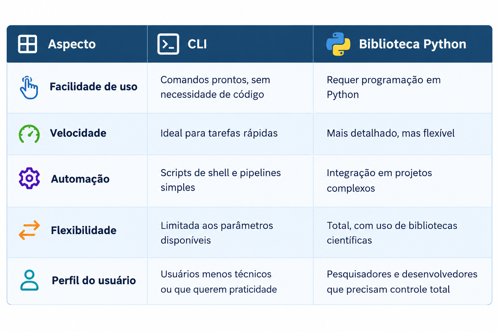
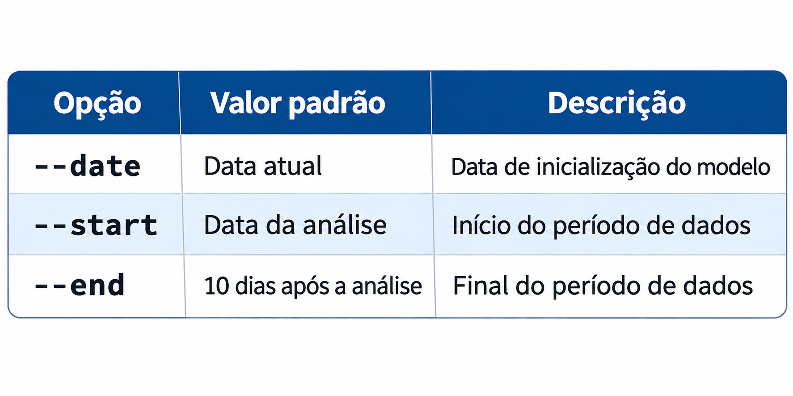

Como Usar
=========

Acesso aos dados do BESM (Modelo Brasileiro do Sistema Terrestre).
------------------------------------------------------------------

Na nova versão dos pacotes de distribuição dos **Modelos Numéricos BESM**, oferecemos duas formas de acessar, filtrar e receber os dados:

- `Interface de Linha de Comando (CLI) <usageCLI.html>`_ 
  - a maneira mais recente e prática, permitindo interação direta com o sistema.

- `Biblioteca Python <usagePython.html>`_  - 
  o método tradicional, que continua disponível para quem prefere integrar o BESM em seus scripts e aplicações.

Comparativo: CLI vs Biblioteca Python
-------------------------------------

.. note::

Horários de inicialização do modelo BESM -  Componente Atmosférico
------------------------------------------------------------------

  O modelo **BESM - Componente Atmosférico** roda com o horário de inicialização de 00 UTC:

  - **00 UTC** → fornece previsões de até **13 meses**.  

  Para acessar uma inicialização especifica utilizar a opção `date`.

  **date = 'YYYYMMDD'**

.. warning::

Datas disponíveis no BESM - para verificar as datas de inicialização disponíveis, consulte o endereço oficial do servidor de dados:  `Dataserver CPTEC <https://dataserver.cptec.inpe.br/dataserver_modelos/besm/brutos/>`_. Nesse diretório estão listadas todas as datas que podem ser utilizadas como condição inicial para requisições ao modelo **BESM**.

Definição do período de dados
------------------------------ 

O modelo **BESM** gera saídas em intervalos regulares de tempo, com frequência diária. Isso significa que cada *step* representa um avanço de **24 horas (1 dia)** em relação ao passo anterior.

A contagem dos *steps* começa em `0`, que corresponde à data e ao horário de inicialização do modelo. A partir desse ponto, cada passo representa o estado previsto para o dia seguinte.

Dessa forma:

- ``--start 0`` - seleciona a saída correspondente à condição inicial do modelo.
- ``--start 1`` - seleciona a previsão para 24 horas após a inicialização.
- ``--start 2`` - seleciona a previsão para 48 horas após a inicialização.
- ``--end 10`` - define o limite final do período em 10 dias de previsão (240 horas após a inicialização).

As opções ``--date``, ``--start`` e ``--end`` permitem definir a condição inicial do modelo e o período de dados que será carregado.

- ``--date``, ``-d DATE``: define a data de inicialização do modelo, no formato `YYYYMMDD`. Essa data identifica a condição inicial (*initial condition*) utilizada na execução do modelo.
- `--start`, `-s START`: define o início do período de dados a ser carregado. Pode receber um valor inteiro, entre `0` e `395`, representando o número de dias ou passos relativos à inicialização, ou uma data explícita no formato `YYYYMMDD`. O valor `0` corresponde à própria data de inicialização do modelo.
- ``--end``, ``-e END``: define o final do período de dados a ser carregado. Aceita valores entre `0` e `395`, relativos à data de inicialização, ou uma data explícita no formato `YYYYMMDD`.

Quando ``--start`` e ``--end`` são informados como valores numéricos, eles representam o intervalo relativo à data de inicialização do modelo.
Por exemplo, ``--start 0 --end 10`` seleciona o período desde a inicialização até 10 dias após essa data.

Exemplos de uso
---------------

**1. Informando o período por datas**

É possível informar diretamente as datas de início e fim do período:

.. code-block:: console

  besm_load --var t2mt --date 20261110 --start 20261110 --end 20261111

Nesse exemplo, são carregados os dados da variável `t2mt`, considerando a inicialização do modelo em 10/11/2026 e o período entre 10/11/2026 e 11/11/2026.

**2. Informando o período por valores relativos**

Também é possível definir o intervalo em relação à inicialização do modelo:

.. code-block:: console

  besm_load --var t2mt --date 20261110 --start 0 --end 10

Nesse caso, os dados são carregados desde a data de inicialização (10/11/2026) até 10 dias após essa data.

Valores padrão
--------------

Caso as opções não sejam informadas, o comando utiliza os seguintes valores padrão:

Assim, é possível executar o comando sem informar essas opções, utilizando automaticamente as datas padrão:

.. code-block:: console

  besm_load --var t2mt

**Observação:** os valores relativos de ``--start`` e ``--end`` devem estar entre `0` e `395`, respeitando o período de dados disponível para a inicialização selecionada.

